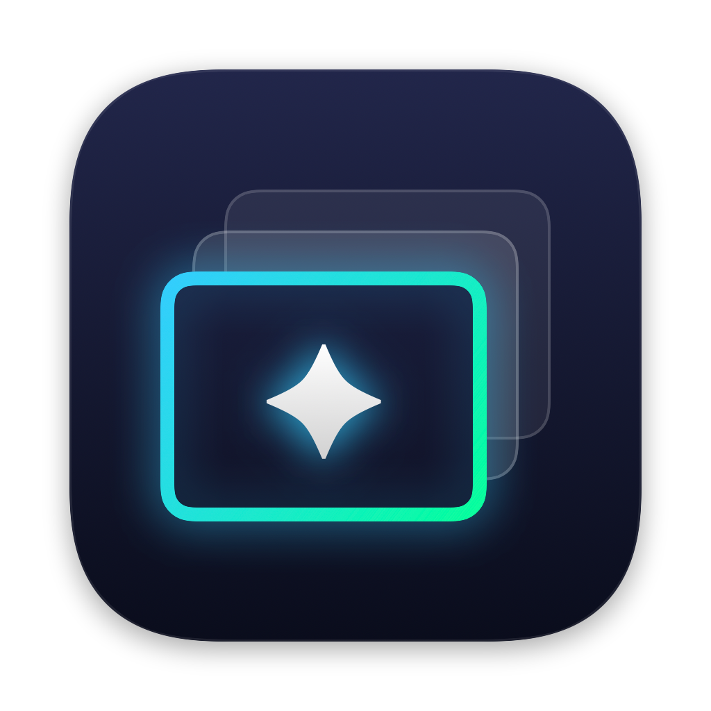
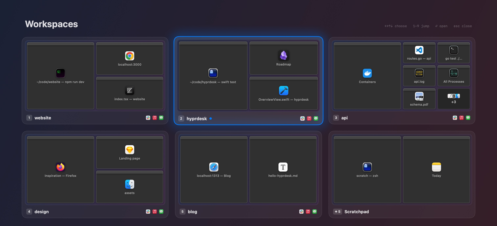

<p align="center">
  
</p>

<h1 align="center">HyprDesk</h1>

<p align="center">
  <strong>Hyprland-style workspaces for macOS.</strong><br>
  Virtual desktops inside your first macOS desktop, one per project, one keystroke apart.
</p>

<p align="center">
  
  
  
</p>

<p align="center">
  <a href="#getting-started">Getting started</a> ·
  <a href="#shortcuts">Shortcuts</a> ·
  <a href="#the-scratchpad">Scratchpad</a> ·
  <a href="#command-line-and-links">Command line</a> ·
  <a href="#how-it-works">How it works</a>
</p>

<p align="center">
  
</p>

## Why

macOS Spaces slide on every switch, and ⌘Tab drags you across them to wherever an app happens to be. Tiling window managers fix that, but take over how every window is laid out.

HyprDesk does the part in between, the way [Hyprland](https://hypr.land) does workspaces: a window lives in the workspace it opened in until you move it, switching is instant, and nothing about your windows' size or position changes. Your other macOS desktops stay exactly as they are.

## Features

- **Workspaces, not Spaces.** Your whole first desktop becomes as many workspaces as you like: terminals, editors, browsers, Finder windows and design files, each in their own. Switching shows only that workspace's windows, with no animation.
- **Any window, any workspace.** Two Chrome or Ghostty windows can sit in two workspaces, kept apart: ⌘Tab only ever offers the ones where you are.
- **The shortcuts you know, scoped.** ⌘Tab, ⌃← ⌃→, ⌃↑ and ⌃↓ keep working, showing only the workspace you're in.
- **A scratchpad.** A terminal, notes or a chat, called up over any workspace with one key and put away again.
- **Find any window.** ✦ Space searches every window in every workspace by title, app or workspace name.
- **Remembered.** Every window's workspace survives restarts of HyprDesk, of its app, and of your Mac.
- **Scriptable.** A `hyprdesk` command line and `hyprdesk://` links that answer in JSON, for scripts, launchers and AI agents.
- **Hands off macOS.** Nothing is replaced or turned off. Suspend HyprDesk and every window is back, with macOS's own shortcuts.

## Getting started

HyprDesk needs macOS 15 and Xcode 16 (or the Swift 6 toolchain). There's no packaged release yet, so build it:

```sh
git clone https://github.com/nicbet/hyprdesk.git && cd hyprdesk
make signing-cert   # once: a local signing certificate, so permissions survive rebuilds
make run            # builds build/HyprDesk.app and launches it
make install-cli    # optional: the `hyprdesk` command, in ~/.local/bin
```

1. **Allow Accessibility** when asked: HyprDesk needs it to see, move and focus windows. Screen Recording is optional; it adds window pictures to ⌃↓ and the scratchpad's backdrop.
2. **Pick a hyper key.** HyprDesk's own shortcuts use ✦, the hyper key: ⌃⌥⌘ held together. In Manage Workspaces ▸ Shortcuts, turn Caps Lock or a right-hand ⌘, ⌥ or ⌃ into one; it then works as ⌃⌥⌘ in every app, until HyprDesk quits. Already have a hyper key from Raycast or Karabiner-Elements? Leave the setting off and keep yours, as long as it doesn't include Shift: ✦ ⇧ means "move".
3. **Make workspaces** from the menu-bar icon ▸ Manage Workspaces…, then press ✦ 1, ✦ 2 and so on. New windows join the workspace you're in.

## Shortcuts

| Keys | |
| --- | --- |
| ✦ 1–9 | Switch to that workspace |
| ✦ ⇧ 1–9 | Move the focused window to that workspace, and follow it |
| ✦ ` | Back to the previous workspace |
| ✦ Space | Find any window, in any workspace |
| ✦ S | Show or hide the scratchpad |
| ✦ ⇧ S | Move the focused window into the scratchpad, or back out |
| ⌃← ⌃→ | Previous / next workspace, in place of macOS's desktops |
| ⌃↑ | The overview: every workspace as a card, its windows tiled, the frontmost largest |
| ⌃↓ | The workspace's Mission Control: pictures of its windows |
| ⌘Tab | The workspace's windows, most recent first |

⌘Tab works like macOS's: hold ⌘, press Tab (⇧Tab or the arrows to go back), release to switch, Esc to cancel. A quick ⌘Tab goes straight to the previous window. ⌘Tab and the ⌃-arrows are only taken over while HyprDesk runs, and each can be turned off in Manage Workspaces ▸ Shortcuts. The menu-bar icon shows which workspace you're in.

## The scratchpad

Hyprland's special workspace, on macOS: a place for windows you want now and then, from anywhere. They stay out of sight until ✦ S brings them up, centred over whichever workspace you're in, with the workspace dimmed behind them. ✦ S again, a click on the dimmed workspace or switching workspace puts them away.

✦ ⇧ S sends the focused window into the scratchpad, or back out into the current workspace. Reaching a scratchpad window some other way (⌘Tab, the Dock, ✦ Space) brings the scratchpad up too.

## Finding windows

✦ Space opens a search over every window in every workspace. Type part of a title, an app or a workspace name, then press Return to jump there, switching workspace on the way. Recently used windows come first.

## Command line and links

The app's own binary doubles as its command line. It talks to the running app over a socket only you can open, and every answer is JSON, so scripts and AI agents can drive HyprDesk and read the result:

```sh
hyprdesk list                      # workspaces and their windows: IDs, apps, titles, frames
hyprdesk current                   # the workspace on screen and the focused window
hyprdesk switch 2                  # by number, name, or the start of a name
hyprdesk move 3                    # the focused window, following it (--stay doesn't)
hyprdesk move Work --window 4211   # any window, by its ID from `list`
hyprdesk move scratchpad           # or: everywhere
hyprdesk focus 4211                # switching to its workspace
hyprdesk scratchpad [toggle|show|hide]
hyprdesk find slack                # open the window search with "slack" typed
hyprdesk create "Client X"         # and: hyprdesk rename 4 "Client Y"
```

It exits 1 when HyprDesk refuses (`{"ok": false, "error": "…"}`) and 2 when it isn't running. The same commands work as links from Raycast, Shortcuts or anywhere a URL opens: `hyprdesk://switch/2`, `hyprdesk://move/Work?window=4211`, `hyprdesk://scratchpad/toggle`, `hyprdesk://find?q=slack`.

## How it works

**Parking.** Only the current workspace's windows are on screen. The others are parked just past a bottom corner of their screen: no animation, no macOS Space switch, one Accessibility call per window, every app asked in parallel. A workspace keeps its arrangement, so switching back shows its windows where and in the order you left them.

**Where a window belongs.** A window opens into the workspace you're in and stays there until you move it, with ✦ ⇧ 1–9 or by dragging it in Manage Workspaces. HyprDesk remembers:

- **HyprDesk restarted, apps still running:** every window comes back to its workspace, exactly.
- **An app relaunched, or the Mac restarted:** restored windows find their workspace by app and document, else by title. Reliable for document apps, best effort for terminals and browsers, whose titles change.
- **A brand-new window** never inherits an old window's workspace by coincidence: it joins where you are.

Windows, or whole apps like Slack or Music, can show in every workspace instead: right-click a window in Manage Workspaces ▸ Show in Every Workspace, or Show <App> in Every Workspace. In the overview, their apps sit beside each workspace's name, and the scratchpad has a card of its own while it holds windows.

**The Dock, notifications and other ways in.** HyprDesk doesn't change the Dock. Clicking an app there brings the app forward, and HyprDesk keeps you where you are whenever it can:

| Clicking an app in the Dock that… | takes you |
| --- | --- |
| has a window in this workspace | nowhere: that window comes forward |
| has windows only in other workspaces | to the workspace of the one you used last |
| has windows only in the scratchpad | nowhere: the scratchpad comes up over where you are |
| shows in every workspace | nowhere: it comes forward |
| has no windows open | nowhere: most apps open a new window, in the workspace you're in |
| isn't running | nowhere: it launches, restored windows go back to their workspaces, new ones open where you are |

Clicking a notification works the same way, since to macOS it's the app coming forward too. Asking for one particular window always takes you to it, wherever it lives: from ✦ Space, the overview, an app's Window menu while you're in that app, or `hyprdesk focus`.

**One macOS desktop.** HyprDesk manages the macOS desktop its windows are on. Every other desktop stays plain macOS, a place for presentations and full-screen apps, and while you're there HyprDesk keeps its hands off. ⌃← ⌃→ past your first or last workspace go on to the neighbouring desktop, so the same keys take you there and back.

**Nothing gets lost.** Quitting HyprDesk, even with `pkill` or Ctrl-C, puts every parked window back. After a crash or a force quit, the next launch does. Suspend HyprDesk from the menu and every window is on screen with macOS's own shortcuts until you resume.

## Known limitations

- **Native full screen** windows live in their own macOS Space and can't be parked; use a maximised window instead.
- **Trackpad gestures and the Mission Control key** still do macOS's thing, and macOS's Mission Control shows every window, parked ones included (to macOS they're ordinary windows off screen).
- **No packaged release yet:** build from source as above.

## Development

```sh
make dev            # rebuild and relaunch with Manage Workspaces open
make test           # the test suite
make snapshot       # render the overlays with sample data into build/snapshots/
make readme-images  # this README's picture, from the same sample data, into docs/
make icon           # redraw the app icon from scripts/make-icon.swift
```

Builds are signed with the "Local App Signing" certificate from `make signing-cert`, so macOS's permission grants survive rebuilds; without it they're signed ad hoc and the grants reset every time.

`hyprdesk --bench` (in `build/HyprDesk.app/Contents/MacOS/`) opens and closes each overlay on your real windows and logs how long it blocked the main thread and how many frames came late. Switch timings and the rest: `log stream --predicate 'subsystem == "com.github.nicbet.hyprdesk"'`.

<details>
<summary><strong>Modules</strong></summary>

| Module | |
| --- | --- |
| `WindowKit` | Every standard window via Accessibility: listing, observing, moving, focusing; screen geometry. No workspaces. |
| `Spaces` | Workspaces and which one each window belongs to (sticky apps, the scratchpad), saved to disk. No AppKit. |
| `Workspaces` | The engine: parks and restores windows, switches, follows focus, recovers after a crash. |
| `Overview` | ⌃↑: the cards and their tiled windows, keyboard navigation, snapshots. |
| `Expose` | ⌃↓: the workspace's Mission Control, its layout and thumbnails. |
| `Switcher` | ⌘Tab: the switcher's model and HUD. |
| `Search` | ✦ Space: ranking windows by title, app and workspace. |
| `Control` | The command line and links: parsing commands, JSON, the socket to the running app. |
| `HyprDesk` | The app: menu-bar item, Manage Workspaces window, hotkeys and key tap, overlay panels. |

</details>

## Acknowledgements

HyprDesk borrows its workspace model, its scratchpad and its name from [Hyprland](https://hypr.land); the icon wears Hyprland's active-window border. Parking windows off screen instead of using macOS Spaces is the trick [AeroSpace](https://github.com/nikitabobko/AeroSpace) made popular.

## License

[MIT](LICENSE) © Nicolas Bettenburg
